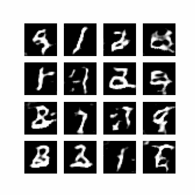

# DCGAN MNIST

An experiment in handwritten-digit generation using a deep convolutional generative adversarial network (DCGAN).

The generator uses transposed-convolution layers to synthesize digit images, while a convolutional discriminator learns to distinguish generated samples from MNIST images. The experiment explores adversarial training dynamics and architectural hyperparameters.

## Methodology

- Tune generator and discriminator filters, layers, kernel configurations, and dropout.
- Explore learning rates and batch sizes with Keras Tuner.
- Inspect generated digit samples and training progression.
- Evaluate generated-image quality using Inception Score and Fréchet Inception Distance as implemented in the notebook.

## Artifacts

**Training Progression**

## Notebook
[Model development](model_development.ipynb)